  

### 👋 Olá, eu sou o Johw

Desenvolvedor de software na **[Intelbras](https://www.intelbras.com.br)**, onde trabalho com **dispositivos de controle de acesso e reconhecimento facial**: integração, firmware e ferramentas em volta do hardware.

- 🔐 **Foco atual:** biometria facial, integrações com controladores de acesso e APIs de dispositivos
- 🛠️ **Fora do trabalho:** IoT com ESP32, automação residencial e projetos de hardware com impressão 3D
- 🪙 **Interesses:** cripto, privacidade e segurança. Sou um dos administradores do **[Guia Anônima](https://guiaanonima.com)**
- 🎓 Formado em Ciência da Computação

### 🚀 Projetos em destaque

| Projeto | Descrição |
| --- | --- |
| [**IntelbrasModoOnlineElectron**](https://github.com/johwconst/IntelbrasModoOnlineElectron) | Servidor em Electron para o modo online dos controladores de acesso Intelbras |
| [**FaceQualityAssurance**](https://github.com/johwconst/FaceQualityAssurance) | Valida a qualidade de fotos de rosto antes do cadastro em dispositivos de reconhecimento facial |
| [**keystrokeDynamics2FA**](https://github.com/johwconst/keystrokeDynamics2FA) | Segundo fator de autenticação baseado no ritmo de digitação (keystroke dynamics) |
| [**TextoDaFotoBot**](https://github.com/johwconst/TextoDaFotoBot) | Bot do Telegram que extrai o texto de imagens (OCR) |
| [**DuinoCoinRig**](https://github.com/johwconst/DuinoCoinRig) | Rig de mineração de Duino-Coin com ESP32, display OLED e case impresso em 3D |

### 🧰 Stack

  <picture>
    <source media="(prefers-color-scheme: dark)" srcset="https://skillicons.dev/icons?i=go%2Cpy%2Cc%2Ccpp%2Ccs%2Cts%2Cjs&theme=dark" />
    
  </picture>
   
  <picture>
    <source media="(prefers-color-scheme: dark)" srcset="https://skillicons.dev/icons?i=react%2Cnextjs%2Cangular%2Celectron%2Cflutter%2Cnodejs%2Cdjango&theme=dark" />
    
  </picture>
   
  <picture>
    <source media="(prefers-color-scheme: dark)" srcset="https://skillicons.dev/icons?i=opencv%2Carduino%2Clinux%2Cdocker%2Cpostgres%2Cgit&theme=dark" />
    
  </picture>

### 🐍 Contribuições

  <picture>
    <source media="(prefers-color-scheme: dark)" srcset="https://raw.githubusercontent.com/johwconst/johwconst/output/github-snake-dark.svg" />
    
  </picture>

### 📫 Contato

  
  
  
  

